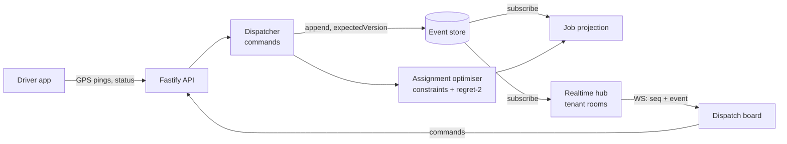

# FleetFlow

[](https://github.com/ndanetaadmire-debug/fleetflow/actions/workflows/ci.yml)


**Real-time dispatch for field-service and logistics teams.** FleetFlow assigns jobs to the right driver, tracks them live from GPS, detects arrival automatically and streams every change to the dispatch board over WebSockets — with a complete, replayable history of every job.

## Highlights

**Constraint-aware batch assignment (regret-2 heuristic).** Greedy "closest driver" dispatch lets an easy job steal the only technician qualified for a hard one. FleetFlow scores every feasible (job, driver) pair — skills, tenant, GPS freshness, capacity, *can they finish before their shift ends?* — then assigns first the job with the most to lose. It's the standard VRP construction heuristic: near-optimal in practice, `O(J²·D)`, and explainable to ops staff. A test proves it beats greedy on exactly that case.

**Event-sourced job lifecycle.** `JobCreated → JobAssigned → DriverEnRoute → DriverArrived → JobCompleted` (plus unassign / fail / cancel) with an explicit transition table and per-stream optimistic concurrency. The read model is a pure fold over events — a test asserts `replay(events) == projection`. SLA reports ("on site before due time?") are derived from history, not from mutable flags.

**GPS done properly.** Out-of-order pings (common on mobile networks) are dropped; entering a 100 m geofence of an assigned job emits `DriverArrived` automatically; stale fixes exclude a driver from dispatch.

**Self-healing.** A driver going offline releases their not-yet-started jobs back to the pool for re-dispatch.

**Tells you why.** Unassignable jobs come with a reason: *no drivers online*, *no online driver has skills: gas*, *qualified drivers have stale GPS*, *at capacity*, *can't finish before shift end*.

**Live, tenant-isolated, resumable streams.** WebSocket fan-out per tenant; every message carries a global `seq`; reconnect with `?since=<seq>` to replay exactly what you missed; slow consumers are disconnected rather than buffered without bound.

## Architecture



| Path | Responsibility |
|---|---|
| `src/domain` | Job/Driver model, haversine + ETA |
| `src/events` | Event types, transition table, fold, append-only store with optimistic concurrency |
| `src/dispatch` | Constraints, cost function, regret-2 planner, dispatcher service |
| `src/realtime` | Tenant-scoped WebSocket hub with back-pressure |
| `src/http` | REST + `/v1/live` WebSocket, Zod validation, error mapping |

## API

| Method | Path | Purpose |
|---|---|---|
| `POST` | `/v1/drivers` | Register / update a driver |
| `POST` | `/v1/drivers/:id/location` | GPS ping (`{ location, at }`) → may emit `DriverArrived` |
| `POST` | `/v1/drivers/:id/status` | Online/offline (offline releases work) |
| `POST` | `/v1/jobs` | Create job |
| `POST` | `/v1/dispatch` | Run the optimiser for the tenant |
| `POST` | `/v1/jobs/:id/{assign,en-route,complete,fail,cancel}` | Lifecycle commands (illegal → `409`) |
| `GET` | `/v1/jobs/:id/history` | Full event history |
| `GET` | `/v1/reports/sla` | On-time arrival rate |
| `WS` | `/v1/live?tenant=&since=` | Live event stream with replay |

```bash
npm ci && npm run dev     # :8080
npm run ci                # typecheck + 16 tests + build
```

## Production notes

- The in-memory event store has the same contract as a Postgres `events(stream_id, version) UNIQUE` table or EventStoreDB; swapping it is an adapter.
- Tenant comes from a header for clarity; in production it is taken from the verified JWT.
- `etaSeconds` uses haversine × detour factor; replace with OSRM/Google Routes behind the same signature when precision is worth the cost.

---

Built by **[Admire T. Ndaneta](https://admire-portfolio.vercel.app)** — senior full-stack engineer. MIT licensed.
